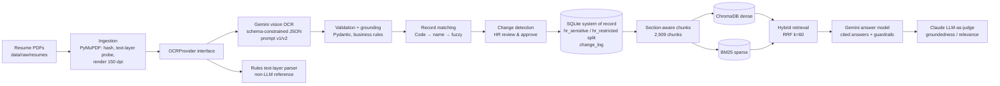

# IRM – Intelligent Resume Management Application

-blue)


| | |
|---|---|
| **Program / track** | upGrad – Generative AI · Bring Your Own Capstone |
| **Author** | Phuong Dang |
| **Submission** | Mid-submission – **Version 1 (Baseline)** of the end-to-end GenAI solution (Weeks 1–2 of 4) |
| **Quick check (no API key)** | `pip install -r requirements.txt` → `pytest -q` → `python run.py week2` → `python run.py ask "Which employees hold an AWS certification?"` |

---

## 1. Project overview

Every year each employee uploads an updated resume (PDF). Today HR reads every resume, finds the
employee and re-types the changes into the employee database, case by case. **IRM** automates this:

1. **Reads** each resume with a vision-capable Gemini model (OCR + schema-constrained extraction in one call).
2. **Validates and matches** the extraction to the existing employee record (Code → exact name → fuzzy name).
3. **Detects changes** field by field so HR only *reviews and approves* what changed.
4. **Indexes** resume sections for hybrid retrieval (ChromaDB + BM25, Reciprocal Rank Fusion) so HR and
   business-unit leaders can **ask staffing questions in natural language** and get **cited answers**.
5. **Evaluates** itself: field-level P/R/F1 with an error taxonomy, retrieval Hit@k / MRR, and an
   independent **LLM-as-judge (Claude)** for answer quality and guardrails.

Deployment model: **standalone pilot** – IRM works on its own copy of the employee dataset; there is no
integration with enterprise systems until the pilot has been assessed.

## 2. Business objective

| Objective | Success metric (target) |
|---|---|
| Replace manual re-typing with review-and-approve | Field-level extraction F1 **≥ 0.90**; HR time per resume reduced vs. manual baseline |
| Update the right employee record | Record-matching accuracy **≥ 99%** |
| Show HR only what changed | Change-detection precision / recall vs. 1,331 known changes |
| Make the workforce searchable by skill, project, experience | Hybrid + rerank Hit@5 / MRR > dense-only; Ragas faithfulness ≥ 0.85, relevance ≥ 0.80 |
| Protect personal data | 100% safe handling of the guardrail query set; sensitive fields never sent to an LLM |

**Why Generative AI.** Resumes are free-form and some are scanned images. A vision LLM performs OCR,
layout understanding and extraction into the target schema in one call; a retrieval-augmented LLM turns
the dataset into a cited natural-language search tool. Evidence from this baseline: the non-LLM rules
parser scores F1 1.000 on digital PDFs but **0.000 on scanned PDFs**.

Scope (capstone): internal staffing only (no recruitment content); PDF input only; Gemini API for
OCR/extraction and answers; Claude API as independent judge only; no model weight fine-tuning.

## 3. Dataset source and licence

| | Employee_profile | Employee_resume |
|---|---|---|
| **Source** | Synthetic tabular dataset generated with CTGAN (Google Colab) from the author's own dummy R&D employee data – all names and details are fictitious | 281 PDF resumes rendered from a random sample of Employee_profile (`scripts/generate_resumes.py`, ReportLab, seed 42) |
| **In this repository** | `data/raw/employee_profile_dataset.csv` (999 records × 48 fields) | `data/raw/resumes/*.pdf` + `data/raw/resume_manifest.csv` (ground truth of 1,331 changed values) |
| **Mirror** | [Google Drive folder](https://drive.google.com/drive/folders/1VVU0Rf7A18Zmc2xipWLeLFWnN3vNL_o9?usp=sharing) | same |
| **Licence** | Author's own work – permission granted for use in this upGrad capstone (not an open licence) | same |

The full dataset is committed, so **no download is needed**. 30 scan-style variants (3 degradation levels)
are regenerated by `python run.py scans` (part of `week2`).

**Preprocessing** (`src/irm/database.py`, log in `data/processed/cleaning_report.json`): phone kept as text with
"+", whitespace normalisation, e-mail lower-cased, `YearOfIssue` as nullable integer (19 records without a
certificate kept as NULL – no imputation), ordinal `TitleRank`, Code uniqueness asserted, multi-value fields
exploded into child tables, **sensitive and restricted fields split into separate tables**.

**Limitations / bias.** One resume template; generated project text; class imbalance (595 Senior vs 4 Fresher
in the profile, 1 Fresher among the resumes); English-only resumes; Vietnamese names only.

## 4. Architecture (Version 1) and build status



| Component | Module | V1 status |
|---|---|---|
| Ingestion, OCR provider interface, Gemini OCR, rules reference | `ingestion.py`, `ocr/` | Done |
| Versioned extraction prompts v1 / v2 | `prompts.py` | Done |
| Validation + grounding, record matching | `validation.py`, `matching.py` | Done |
| EDA, scan variants, cleaning, SQLite with sensitive/restricted split | `eda.py`, `scans.py`, `database.py` | Done |
| Chunking, ChromaDB + BM25 + RRF | `chunking.py`, `retrieval/` | Done (LSA embedder offline; Gemini/BGE embedders implemented, index pending) |
| Cited answer generation with guardrail prompt | `answering.py`, `run.py ask` | Built; offline in retrieval-only mode |
| Evaluation: extraction P/R/F1 + error taxonomy, retrieval metrics, LLM-as-judge | `evaluation/` | Done; judge run pending (API credit) |
| Change-detection review UI, cross-encoder reranker, LlamaIndex orchestration, Ragas | – | Planned (final submission) |

### Prompt and interaction design

* **Extraction** (`src/irm/prompts.py`, `src/irm/ocr/gemini.py`): page images + versioned prompt, temperature 0,
  JSON output constrained to the Pydantic schema (`src/irm/schema.py`), response cache keyed by
  model + prompt version + file hash, tokens and latency logged per call. Prompt **v1** is the baseline;
  **v2** adds rules for header field swaps, experience printed in months, copying skill-years exactly,
  separating language tests from certificates, the education-line rule (IRM-W1-01), project order and
  "never guess on unreadable scans". Sensitive fields are not extracted by design.
* **Answering** (`src/irm/answering.py`): the answer model sees only the top-k hybrid-retrieved chunks (sensitive
  and restricted fields are never indexed), must cite chunk ids, must say what is missing instead of guessing,
  and must refuse sensitive-data, prompt-injection, external-recruitment and off-topic requests.
* **Judging** (`src/irm/evaluation/answer_eval.py`): Claude scores groundedness, answer relevance, context
  relevance and correct refusal – a different provider from the answer model to reduce self-preference bias.

## 5. Repository structure

```
application/
├── src/irm/                    # production package
│   ├── config.py               # all paths, model pins, constants (reads .env; works without it)
│   ├── schema.py               # Pydantic extraction schema + mapping to Employee_profile
│   ├── ingestion.py            # PDF discovery, page rendering, text-layer probe (PyMuPDF)
│   ├── ocr/                    # OCRProvider interface: gemini.py, textlayer.py (reference), claude.py (experiment)
│   ├── prompts.py              # versioned extraction prompts (v1, v2)
│   ├── validation.py           # business rules + grounding check -> HR review fields
│   ├── matching.py             # record matching (Code -> exact name -> fuzzy name)
│   ├── ground_truth.py         # expected values from Employee_profile + manifest
│   ├── extraction_runner.py    # batch runs, sample selection, per-run summaries
│   ├── eda.py · scans.py · database.py · chunking.py · baseline.py
│   ├── retrieval/              # embedders (gemini / bge / lsa), Chroma + BM25 + RRF
│   ├── answering.py            # hybrid retrieval -> cited answer (baseline RAG)
│   ├── evaluation/             # extraction metrics, eval set, retrieval metrics, LLM-as-judge
│   └── llm/                    # Gemini / Claude clients, API checks, response cache + cost
├── data/
│   ├── raw/                    # source CSV, manifest, 281 resumes, template
│   ├── processed/              # cleaned CSV, EDA summary, cleaning log, inventories (irm.db rebuilt by run.py)
│   ├── evaluation/             # 20-resume sample, human-check sheet, 79 eval queries, human-label subset
│   ├── index/                  # prebuilt Chroma (LSA) + BM25 indexes (rebuilt by run.py index)
│   └── interim/llm_cache/      # cached Gemini responses -> offline replay of the Week 1 tier runs
├── notebooks/                  # supporting walkthroughs (harness, EDA + retrieval); not the solution itself
├── tests/                      # 24 offline unit / integration tests (LLM clients mocked)
├── docs/
│   ├── evaluation/             # model pins, tier comparison, answer-eval run records
│   ├── baseline/               # manual-baseline protocol, HR timesheet, workload statistics
│   ├── figures/                # EDA and result charts (assets)
│   └── issue_log.md            # issues, decisions and open actions (IRM-W1-xx, IRM-W2-xx)
├── scripts/                    # dataset generator (provenance), notebook builder, result charts
├── run.py                      # single CLI entry point
├── requirements.txt · .env.example · LICENSE
```

**Configuration** is centralised in `src/irm/config.py` (paths, constants, guardrail field lists) and
`.env.example` (model IDs, keys, prices) instead of a separate `configs/` folder; figures (assets) are in `docs/figures/`.

## 6. Installation

Requires Python 3.10+ (developed and tested on 3.13).

```bash
git clone https://github.com/bavatino-ai/IRM.git
cd IRM
python -m venv .venv
source .venv/bin/activate            # Windows: .venv\Scripts\activate
pip install -r requirements.txt
```

**API keys are optional.** All steps in 7.1 run without a `.env` file. To make new API calls:

```bash
cp .env.example .env                 # Windows: copy .env.example .env
# then set GEMINI_API_KEY (OCR + answers) and ANTHROPIC_API_KEY (judge)
```

Keys are read only from the environment; nothing is hard-coded. Optional `PRICE_IN_*` / `PRICE_OUT_*`
values (USD per 1M tokens) enable cost tracking.

## 7. Execution steps

Entry point: `python run.py <command>` (list: `python run.py -h`).

### 7.1 Offline – no API key, no manual changes

```bash
pytest -q                          # 24 tests (Gemini / Claude clients mocked)
python run.py week2                # EDA, scan variants, SQLite, chunks + Chroma/BM25, eval set, retrieval check (~30 s)
python run.py week1                # 20-resume sample + human-check sheet, workload stats, rules reference baseline

# Replay the Week 1 Gemini extraction from the committed response cache (no key needed)
python run.py extract --provider gemini --model gemini-3.5-flash-lite --prompt v1 --set sample   # F1 0.999

# Baseline RAG interaction: without a key it prints the guardrail prompt + retrieved, cited context
python run.py ask "Which employees hold an AWS certification?"
```

Outputs land in `data/processed/`, `data/evaluation/`, `data/index/`, `docs/` and `data/interim/extractions/`.

### 7.2 With API keys

```bash
python run.py check-apis                                   # pins model versions -> docs/evaluation/model_pins.json
python run.py ask "Who worked on a Fintech project with React.js?"   # Gemini cited answer
python run.py compare-tiers --prompt v1                    # Gemini tier comparison on the 20-resume sample
python run.py before-after --model gemini-3.5-flash-lite   # prompt v1 vs v2
python run.py extract --provider gemini --set sample-scan --prompt v2   # scan robustness
python run.py answer-eval                                  # Gemini answers, Claude judges (20-query subset)
python run.py index --embedder gemini && python run.py retrieval-check --embedder gemini
```

The Gemini free tier allows about 20 requests per model per day; the client paces requests
(`GEMINI_MIN_INTERVAL_S`), does not retry 4xx errors and stops cleanly when the daily quota is reached.

## 8. Current implementation status (end of Week 2)

| Measure | Target | Result | Status |
|---|---|---|---|
| Extraction F1 – Gemini, 20-resume sample, digital PDFs | ≥ 0.90 | **0.999** gemini-3.5-flash-lite (20/20 parsed) · 0.989 gemini-2.5-flash (18/20, quota) | Done (digital) |
| Harness validation – rules reference, 281 resumes, 6,925 field slots | – | F1 0.984 (v1) → **1.000** (v2) after one fix round; scans 0.000 | Done |
| Record-matching accuracy | ≥ 99% | **100%** – 281/281 (reference), 20/20 (Gemini) | Done |
| Change-detection ground truth | – | 1,331 known changes in 262 of 281 resumes | Done |
| Retrieval Hit@5, 62 queries (offline LSA embedder) | hybrid + rerank > dense | Dense 0.742 · BM25 0.935 · Hybrid RRF 0.855 | Partial |
| Evaluation set | – | 79 queries (incl. 9 guardrail, 8 analysis); 27-query human-label subset | Done / labels pending |
| Answer quality + guardrails (LLM-as-judge) | ≥ 0.85 / 0.80; 100% guardrails | Pipeline built and tested offline; run blocked by Anthropic API credit | Pending (API) |
| HR time per resume | reduction vs. manual | Protocol ready (`docs/baseline/`); workload: 24.6 values read, 4.74 change per resume | Open |

Gemini model selection (proposed): **gemini-3.5-flash-lite** – lowest-price tier, highest F1, 100% schema-valid,
7.9 s per resume. Details: `docs/evaluation/tier_comparison_v1.csv`; decisions and issues: `docs/issue_log.md`.

## 9. Known limitations

* **Partial Gemini evidence:** digital extraction measured on 20 resumes; the scanned-resume run, the higher
  tier (`gemini-3.1-pro-preview`, no free-tier quota) and the prompt v1 → v2 before/after are pending.
* **API access:** free-tier quota (~20 requests/model/day); the Anthropic account has no credit, so the
  judge run has not executed (the two `docs/evaluation/answer_eval_*` files record the blocked attempts
  from the swapped-role experiment); token prices are not yet configured, so cost per resume is not reported.
* **Synthetic, single-template corpus:** real resumes will vary far more in layout and wording.
* **Optimistic retrieval scores:** eval queries reuse template wording (favours BM25); the dense side uses the
  offline LSA fallback; numeric-threshold questions ("≥ N years of X") score Hit@5 0.38–0.62 and need a SQL filter.
* **Human validation outstanding:** 486 expected field values and 27 query labels not yet human-checked;
  HR timing not measured.
* Not yet in V1: LlamaIndex orchestration, cross-encoder reranker, HR review UI, Ragas.

## 10. Planned improvements for the final submission

**Week 3 – end-to-end first draft**
* Gemini extraction with prompt v2 (+ "9 tracked skills only" rule, IRM-W1-12); before/after and scan run.
* Change detection with HR approval (Streamlit review UI) → dataset update with `change_log` audit trail.
* Gemini and BGE embedding indexes; cross-encoder reranking; LlamaIndex orchestration of retrieval + answers.
* SQL / metadata-filter tool for numeric questions (IRM-W2-04); guardrail enforcement; first Ragas + Claude-judge run.

**Week 4 – tune and assess**
* Chunking, top-k and prompt tuning; final Ragas, Claude judge and human-checked evaluation; adversarial guardrail test.
* Cost and latency per resume; HR timing session; pilot go / no-go against the business requirements.

**Long-term roadmap (beyond the capstone):** local OCR model behind the same `OCRProvider` interface; DOCX and
image inputs; retrieval fine-tuning; PII redaction before external calls; enterprise-system integration.

## 11. Licence

Code: MIT (see `LICENSE`). Data: author's own synthetic work – permission granted for use in this upGrad capstone only.
